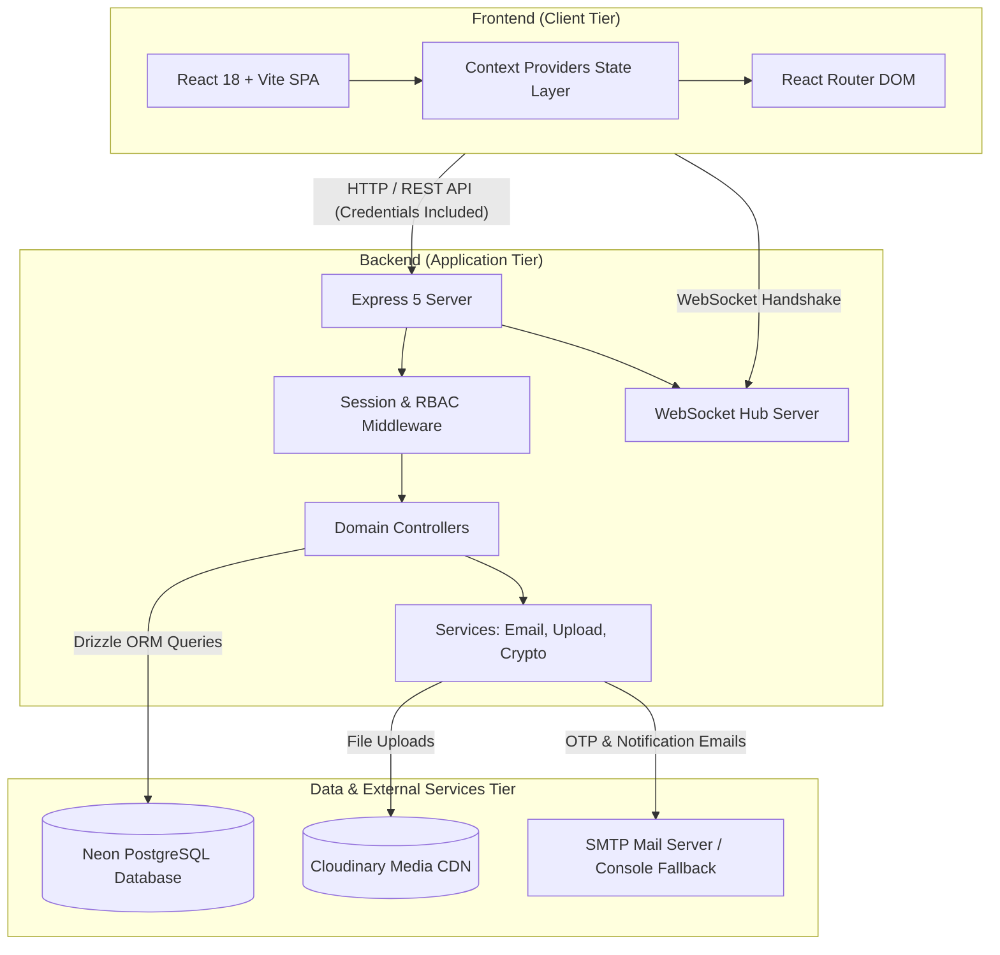
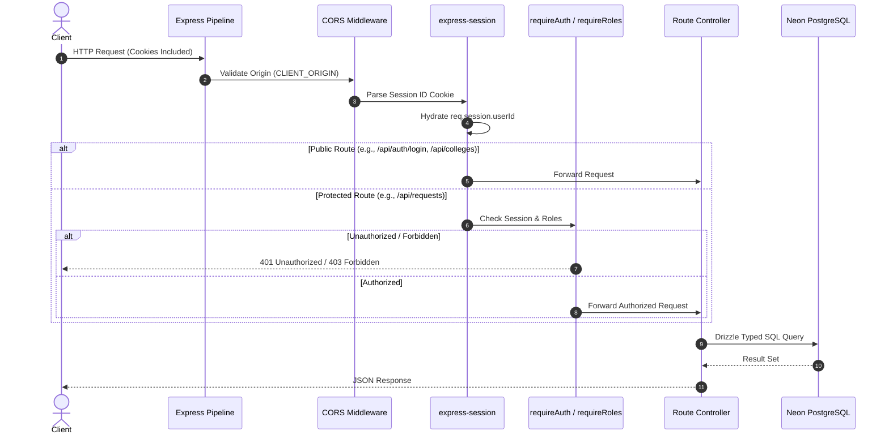
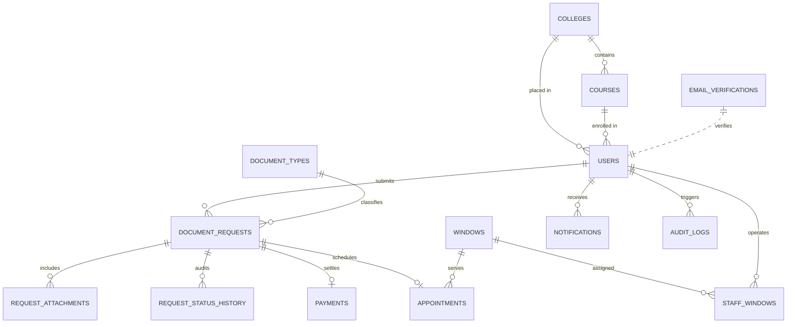
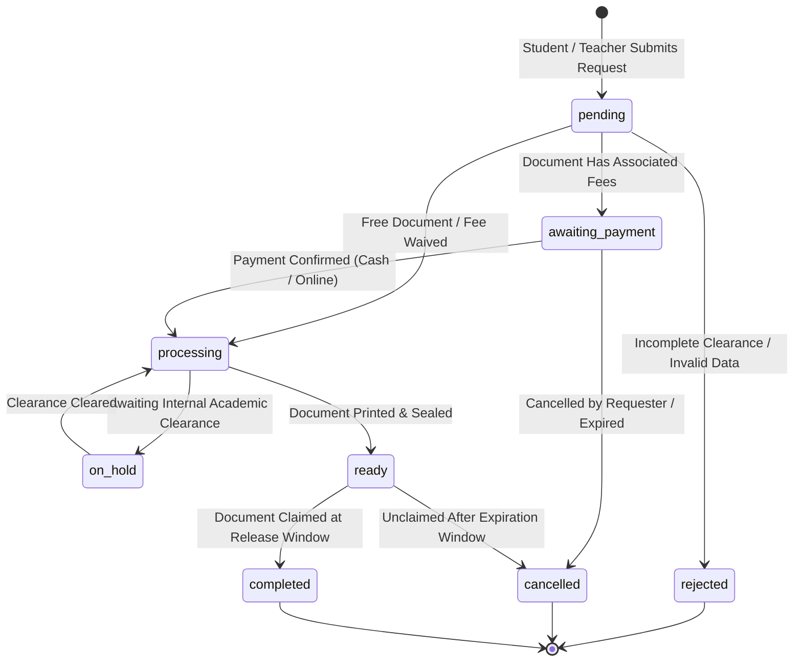

# ARCH System Architecture

This document describes the high-level architecture, module design, database schema, data flows, and security model of the **ARCH School Document Management System**.

---

## 1. System Overview

The system is a full-stack web application designed for higher education institutions (such as TUP Manila) to digitize and manage the end-to-end lifecycle of university credentials and official document requests (e.g., Transcript of Records, Certificate of Grades, Honorable Dismissal, Employment Certifications).

### Key Architectural Characteristics
- **Client-Server Architecture:** Decoupled single-page application (SPA) client communicating with a RESTful Express API via JSON over HTTPS.
- **Session-Based Authentication:** Stateful server sessions backed by `httpOnly` secure cookies.
- **Strict Role-Based Access Control (RBAC):** Distinct functional surfaces for `student`, `teacher`, `staff`, and `admin`.
- **Relational Data Integrity:** PostgreSQL managed through Drizzle ORM with strict foreign keys, check constraints, enums, and automated timestamps.
- **Real-Time Communication:** WebSocket connections for push notifications and instant request status updates.



---

## 2. Tech Stack Summary

| Layer | Technologies | Purpose |
| :--- | :--- | :--- |
| **Frontend** | React, TypeScript, Vite, Tailwind CSS, shadcn/ui, Lucide Icons, Sonner | Interactive UI, state management, and user views. |
| **Routing & Client State** | `react-router-dom`, React Context API, custom hooks (`useAuth`, `useWebSocket`) | Protected client routing and global state synchronizers. |
| **Backend API** | Node.js, Express 5, TypeScript, `express-session`, `cors`, `multer` | REST endpoints, session handling, file processing, and route guards. |
| **Real-Time Layer** | `ws` (WebSocket) | Live notification dispatch and queue status synchronization. |
| **Database & ORM** | Neon PostgreSQL Serverless, Drizzle ORM, Drizzle Kit | Relational storage, schema migrations, and type-safe query building. |
| **Security & Auth** | `bcrypt`, Node.js `crypto`, Session cookies | Password hashing, time-limited OTP hashes, and session validation. |
| **Third-Party Services** | Cloudinary, Nodemailer | Document attachment cloud storage and email delivery. |

---

## 3. Frontend Architecture

The frontend is structured into modular layers adhering to atomic component design and unified provider state contexts.

```
frontend/src/
├── api/             # Typed API clients (auth, colleges, courses, documents, requests, payments)
├── components/      # UI primitives and composite feature components
│   ├── auth/        # RegistrationForm, StudentFields, FacultyFields, OtpVerificationModal
│   ├── layout/      # AppLayout, Sidebar, Navbar, Page Containers
│   └── ui/          # Radix UI + shadcn atomic primitives (Button, Dialog, Select, etc.)
├── hooks/           # Custom reusable hooks (useAuth, useMobile, useNotifications)
├── lib/             # Shared client utilities, constants, tone helpers, formatters
├── pages/           # Route-level views (Home, Dashboard, Windows, Accounts, etc.)
├── provider/        # Global React Context providers (Auth, Theme, Document, Request)
└── types/           # Domain TypeScript interfaces and union types
```

### 3.1. Route Tree & Access Matrix

All routes are declared in [App.tsx](file:///c:/Users/Admin/Desktop/3rd%20Year%20College/CSE1/school-document-management-system/frontend/src/App.tsx). Protected pages are wrapped by `RequireAuth` and optionally `RequireRole`:

| Route Path | View Component | Permitted Roles | Description |
| :--- | :--- | :--- | :--- |
| `/` | `LandingPage` | Public | Institutional portal landing and informational hero. |
| `/login` | `Login` | Public | Email and password authentication form. |
| `/signup` | `Signup` | Public | Multi-role registration with email OTP verification. |
| `/home` | `Home` | All authenticated | Default dashboard customized by role. |
| `/new-request/:id?` | `NewRequest` | `student`, `teacher` | Multi-step request wizard for selecting and ordering credentials. |
| `/my-request` | `MyRequest` | `student`, `teacher` | Personal request history, status tracker, and receipts. |
| `/notifications` | `Notifications` | All authenticated | Inbox for appointment, payment, and release notices. |
| `/dashboard` | `Dashboard` | `admin`, `staff` | Operational overview, queue throughput, and metrics. |
| `/document-manager`| `DocumentManager` | `admin`, `staff` | Document catalog management, fees, and requirements config. |
| `/windows` | `Windows` | `admin`, `staff` | Window assignments, release queues, and counter management. |
| `/administration` | `Administration` | `admin`, `staff` | Request queues, batch processing, and status workflow transitions. |
| `/accounts` | `Accounts` | `admin` | User account lifecycle, role overrides, and activation switches. |
| `/logs` | `Logs` | `admin` | Tamper-evident audit trails and system event logs. |

### 3.2. Context Provider Hierarchy

State is partitioned across specialized React Contexts so changes in high-frequency data (like request status) do not cause full-tree re-renders:

1. **`AuthProvider`**: Manages current authenticated user state (`user`, `login`, `logout`, `checkAuth`).
2. **`ThemeProvider`**: Persists and applies dark/light theme tokens.
3. **`DocumentProvider`**: Caches available document types, fee structures, and required attachments.
4. **`RequestProvider`**: Handles administrative request tables, filters, and batch updates.
5. **`MyRequestProvider`**: Tracks requests owned by the current student/faculty session.
6. **`WindowViewProvider`**: Manages operational state for counter release windows.

---

## 4. Backend Architecture

The server is built with Express 5 using a traditional Controller-Service-Repository pattern backed by Drizzle ORM.

```
backend/src/
├── controllers/     # HTTP request handlers, validation, response serialization
├── db/              # Database connection (db.ts) and Drizzle schema (schema.ts)
├── middleware/      # requireAuth, requireRoles, validateId, error handlers
├── routes/          # Express route definitions grouped by domain resource
├── services/        # Business logic (email.service.ts, cloudinary uploads)
└── migrate.ts       # Database migration runner script
```

### 4.1. Middleware Pipeline

Incoming requests traverse through an ordered middleware chain:



### 4.2. Route Modules

- **[auth.routes.ts](file:///c:/Users/Admin/Desktop/3rd%20Year%20College/CSE1/school-document-management-system/backend/src/routes/auth.routes.ts)**: `/api/auth` — `send-otp`, `signup`, `login`, `logout`, `me`.
- **[colleges.routes.ts](file:///c:/Users/Admin/Desktop/3rd%20Year%20College/CSE1/school-document-management-system/backend/src/routes/colleges.routes.ts)**: `/api/colleges` — Public catalog reads, admin-protected management.
- **[courses.routes.ts](file:///c:/Users/Admin/Desktop/3rd%20Year%20College/CSE1/school-document-management-system/backend/src/routes/courses.routes.ts)**: `/api/courses` — Public program reads, filtering by `collegeId`.
- **[documents.routes.ts](file:///c:/Users/Admin/Desktop/3rd%20Year%20College/CSE1/school-document-management-system/backend/src/routes/documents.routes.ts)**: `/api/documents` — Document catalog, clearance rules, and fee requirements.
- **[requests.routes.ts](file:///c:/Users/Admin/Desktop/3rd%20Year%20College/CSE1/school-document-management-system/backend/src/routes/requests.routes.ts)**: `/api/requests` — Document request submission, status changes, and history.
- **[payments.routes.ts](file:///c:/Users/Admin/Desktop/3rd%20Year%20College/CSE1/school-document-management-system/backend/src/routes/payments.routes.ts)**: `/api/payments` — Payment verification, receipt generation, and proof upload.
- **[appointments.routes.ts](file:///c:/Users/Admin/Desktop/3rd%20Year%20College/CSE1/school-document-management-system/backend/src/routes/appointments.routes.ts)**: `/api/appointments` — Scheduled release slot booking and window dispatch.
- **[notifications.routes.ts](file:///c:/Users/Admin/Desktop/3rd%20Year%20College/CSE1/school-document-management-system/backend/src/routes/notifications.routes.ts)**: `/api/notifications` — Notification retrieval, read receipts, and preferences.
- **[announcements.routes.ts](file:///c:/Users/Admin/Desktop/3rd%20Year%20College/CSE1/school-document-management-system/backend/src/routes/announcements.routes.ts)**: `/api/announcements` — Broadcast institutional notices.

---

## 5. Database Architecture & Business Rules

The database schema is defined in [schema.ts](file:///c:/Users/Admin/Desktop/3rd%20Year%20College/CSE1/school-document-management-system/backend/src/db/schema.ts) using Drizzle ORM for PostgreSQL.

### 5.1. Entity-Relationship Overview



### 5.2. Core Entities & Constraints

1. **`users` Table:**
   - **Role Check Constraints:**
     - `users_college_allowed_roles`: `college_id IS NULL OR role IN ('student', 'admin')`.
     - `users_course_allowed_roles`: `course_id IS NULL OR role IN ('student', 'admin')`.
     - `users_department_allowed_roles`: `department IS NULL OR role IN ('teacher', 'admin')`.
     - `users_year_level_students_only`: `year_level IS NULL OR (role = 'student' AND year_level BETWEEN 1 AND 6)`.
     - `users_office_allowed_roles`: Staff members must specify their operating office (`registrar` or `hr`).
2. **`email_verifications` Table:**
   - Pre-registration OTP storage keeping pending registration attempts out of the main `users` table until verified.
   - Enforces 10-minute expiry, rate-limiting cooldowns, and a maximum of 5 verification attempts.
3. **`document_requests` Table:**
   - Unique generated reference number format.
   - Tracks current status via `request_status` enum.
4. **`payments` Table:**
   - Tracks cash or online transactions (`bank_transfer`, `e_wallet`, `card`).
   - Links to sequentially incremented receipt numbers via `receipt_number_seq`.
5. **`appointments` & `windows` Tables:**
   - Manages physical pickup windows and counter queues to prevent overcrowding at the registrar/HR offices.

---

## 6. Request Lifecycle & State Machine

Every document request follows a governed state progression:



### State Definitions
- **`pending`**: Initial submission received; awaiting review or payment calculation.
- **`awaiting_payment`**: Awaiting student payment via cashier or online receipt upload.
- **`processing`**: Payment verified or free of charge; registrar/HR staff is preparing the physical document.
- **`on_hold`**: Additional requirements or clearances needed before processing can resume.
- **`ready`**: Document is prepared, authenticated, and scheduled for pickup at an assigned window.
- **`completed`**: Document successfully released to student or authorized representative.
- **`rejected`**: Request denied with logged justification reason.
- **`cancelled`**: Request cancelled by the requester prior to processing.

---

## 7. Security Architecture

### 7.1. Authentication & Session Security
- **Passwords:** Hashed using `bcrypt` with salt rounds set to 10.
- **Session Protection:** Session identifiers are stored in HTTP cookies configured with `httpOnly: true` (mitigating XSS extraction) and `sameSite: "lax"` (mitigating CSRF).
- **OTP Verification:** 6-digit numeric OTPs generated cryptographically (`crypto.randomInt`), stored as bcrypt hashes, expiring after 10 minutes.

### 7.2. Authorization & Data Isolation
- **Role Guards:** Route-level middleware (`requireRoles("admin", "staff")`) protects administrative and operational endpoints.
- **Row-Level Ownership:** Non-staff users can only query and mutate document requests, attachments, and appointments that match their own `session.userId`.
- **Database Integrity:** SQL injection is prevented by parameterized Drizzle queries. Role placement is strictly enforced by PostgreSQL check constraints.

---

## 8. Directory Reference Map

| Directory / File | Description |
| :--- | :--- |
| [backend/src/server.ts](file:///c:/Users/Admin/Desktop/3rd%20Year%20College/CSE1/school-document-management-system/backend/src/server.ts) | Express server initialization, middleware mounts, and port listener. |
| [backend/src/db/schema.ts](file:///c:/Users/Admin/Desktop/3rd%20Year%20College/CSE1/school-document-management-system/backend/src/db/schema.ts) | Complete PostgreSQL database schema definitions, relations, and check constraints. |
| [backend/src/controllers/auth.controller.ts](file:///c:/Users/Admin/Desktop/3rd%20Year%20College/CSE1/school-document-management-system/backend/src/controllers/auth.controller.ts) | Registration, login, OTP sending/verification, and session retrieval. |
| [backend/src/services/email.service.ts](file:///c:/Users/Admin/Desktop/3rd%20Year%20College/CSE1/school-document-management-system/backend/src/services/email.service.ts) | Email delivery service via Nodemailer with local development console fallback. |
| [frontend/src/App.tsx](file:///c:/Users/Admin/Desktop/3rd%20Year%20College/CSE1/school-document-management-system/frontend/src/App.tsx) | Client application routing, route guards, and top-level context provider nesting. |
| [frontend/src/components/auth/RegistrationForm.tsx](file:///c:/Users/Admin/Desktop/3rd%20Year%20College/CSE1/school-document-management-system/frontend/src/components/auth/RegistrationForm.tsx) | Multi-role user registration form with validation and OTP modal trigger. |
| [frontend/src/components/auth/StudentFields.tsx](file:///c:/Users/Admin/Desktop/3rd%20Year%20College/CSE1/school-document-management-system/frontend/src/components/auth/StudentFields.tsx) | Dynamic college and course dropdowns connected directly to backend catalog APIs. |
| [frontend/src/api/auth.ts](file:///c:/Users/Admin/Desktop/3rd%20Year%20College/CSE1/school-document-management-system/frontend/src/api/auth.ts) | Client-side API functions for authentication and user verification. |
